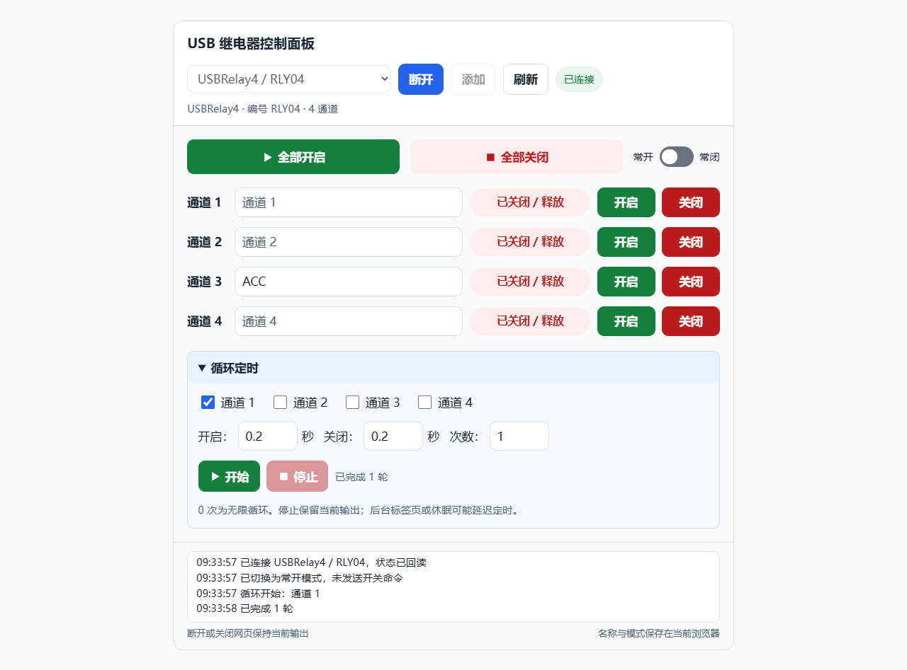
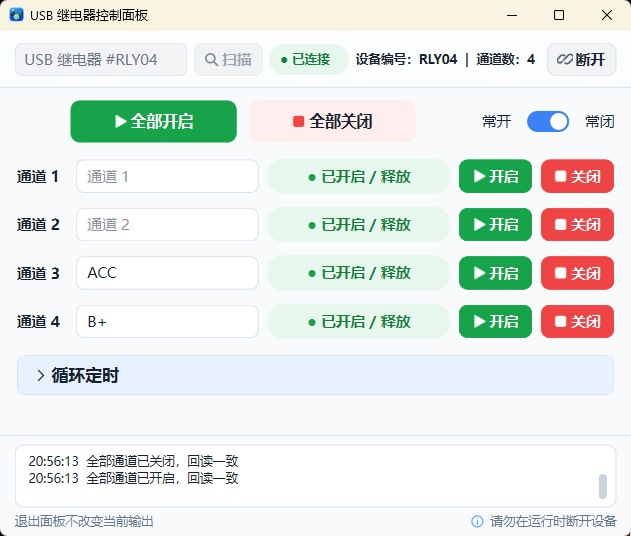

# USB 继电器控制面板 · 精简版

USB HID 继电器控制面板，提供独立单网页与 Windows 64 位便携 EXE 两种版本。

[下载最新便携版](https://github.com/ybyllc/usb-relay-panel/releases/latest)

## 单网页版本

[在线打开网页面板](https://ybyllc.github.io/usb-relay-panel/) · [下载独立 HTML](https://github.com/ybyllc/usb-relay-panel/releases/download/v2026.11.09-compact/USBRelayPanel-web.html) · [网页使用说明](网页使用说明.md)

使用 Chrome / Edge 打开，点击“连接设备”并授权 USBRelay。所有资源内嵌，无需后台服务、Python、原厂 DLL 或联网加载依赖。

- 桌面约 120% 尺寸，窄窗口自动适配，已检查 320–1280 像素宽度。
- 支持单路 / 全部开关、常开 / 常闭、通道命名、多选循环定时。
- 修复首次授权后设备列表不更新，连接后显示设备型号及编号。
- 兼容 8 字节有效载荷和 9 字节带报告 ID 的返回。
- 名称与模式保存在当前浏览器，退出保持输出。后台页面或休眠可能影响定时；切入后台时停止循环。

已用本机 Edge 实际连接 USBRelay4 / RLY04 并读取状态，全程未尝试发送开关命令；30 项模拟测试通过，尚未验证网页物理开关。

## Windows 便携版界面

## 功能

- 支持 USBRelay1 / 2 / 4 / 8，启动时自动扫描并尝试连接上次设备或第一台设备。
- 单路与全部开启 / 关闭，按实际通道数显示控件。
- 通道名称本地保存，支持常开 / 常闭负载模式。
- 多通道循环定时，默认收起；紧凑窗口宽度 600，展开时保持宽度。
- 显示设备回读状态与操作记录；通信失败停止控制，不自动重发。

## 使用

1. 从 [Releases](https://github.com/ybyllc/usb-relay-panel/releases/latest) 下载 ZIP，并完整解压至可写文件夹。
2. 插入继电器，双击 `USBRelayPanel.exe`。
3. 根据实际接线选择常开 / 常闭模式，再操作通道。常开模式下，开启为吸合；常闭模式下，开启为释放。
4. 需要定时操作时，展开“循环定时”，选择通道并填写参数。

断开连接、停止循环和退出面板均保持当前输出。控制时请退出其他继电器控制程序。

程序在自身目录保存 `channel_names.json`、`contact_mode.json`、`last_device.json`；下载包不包含个人配置。更多说明见 [使用说明](使用说明.txt)。

## 通信与验证

开关命令间隔为 200 毫秒，发送后等待 50 毫秒再回读。此措施不能保证消除硬件、负载干扰或固件造成的掉线。通信失败时输出可能已经改变，需要检查后再操作。显示状态来自固件回报，不是机械触点或负载的电气测量。

本次精简版通过 54 项自动化测试；打包程序启动检查识别 USBRelay4，未报告错误。验证过程中未执行真实继电器切换。

本仓库提供独立网页、便携程序发布与使用说明。
